# Manual do Carga em Lote

Público: pessoas que operam as cargas em lote no SEI e no SIP. Alcance: as quatro cargas por arquivo do SEI, as duas cargas por arquivo do SIP e a tela Unidades pelo SIORG. Idioma: português do Brasil. Versão do módulo: 0.3.0. Conferido em laboratório com o SEI 5.0.5.

## Sumário

- [Antes de começar](#antes-de-começar)
    - [O que cada parte faz](#o-que-cada-parte-faz)
    - [Quem pode operar](#quem-pode-operar)
    - [Ordem recomendada das cargas](#ordem-recomendada-das-cargas)
    - [Atenção antes de enviar](#atenção-antes-de-enviar)
- [Preparar o arquivo](#preparar-o-arquivo)
    - [Formatos aceitos](#formatos-aceitos)
    - [Use os arquivos de exemplo](#use-os-arquivos-de-exemplo)
    - [Regras da primeira linha e das colunas](#regras-da-primeira-linha-e-das-colunas)
- [Como funciona uma carga](#como-funciona-uma-carga)
    - [Passos de qualquer carga por arquivo](#passos-de-qualquer-carga-por-arquivo)
    - [Lotes de 50 linhas](#lotes-de-50-linhas)
    - [Simular uma carga](#simular-uma-carga)
    - [Ler o relatório](#ler-o-relatório)
- [Cargas no SEI](#cargas-no-sei)
    - [Abrir a tela Carga em Lote no SEI](#abrir-a-tela-carga-em-lote-no-sei)
    - [Dados Complementares de Unidade](#dados-complementares-de-unidade)
    - [Contato de Usuários](#contato-de-usuários)
    - [Assuntos](#assuntos)
    - [Tipos de Processo](#tipos-de-processo)
- [Cargas no SIP](#cargas-no-sip)
    - [Abrir a tela Carga em Lote no SIP](#abrir-a-tela-carga-em-lote-no-sip)
    - [Unidades e Hierarquia](#unidades-e-hierarquia)
    - [Usuários e Primeiras Permissões](#usuários-e-primeiras-permissões)
- [Unidades pelo SIORG](#unidades-pelo-siorg)
    - [Consultar a estrutura do órgão](#consultar-a-estrutura-do-órgão)
    - [Importar unidades](#importar-unidades)
    - [Atualizar sigla e nome](#atualizar-sigla-e-nome)
    - [Desativar unidades que saíram da estrutura](#desativar-unidades-que-saíram-da-estrutura)
        - [Passo 1, verificar as pendências](#passo-1-verificar-as-pendências)
        - [Passo 2, revisar os alertas](#passo-2-revisar-os-alertas)
        - [Passo 3, confirmar a desativação](#passo-3-confirmar-a-desativação)
- [Solução de problemas](#solução-de-problemas)
    - [Erro de arquivo do tipo errado](#erro-de-arquivo-do-tipo-errado)
    - [Mensagens de erro nas linhas](#mensagens-de-erro-nas-linhas)
    - [O SIORG não responde ou recusa o código](#o-siorg-não-responde-ou-recusa-o-código)
    - [A verificação de desativação não consegue consultar o SEI](#a-verificação-de-desativação-não-consegue-consultar-o-sei)

## Antes de começar

O Carga em Lote cadastra e atualiza muitos registros de uma vez a partir de uma planilha. Em vez de abrir uma tela por unidade, por usuário ou por assunto, você envia um arquivo e a tela mostra, linha por linha, o que aconteceu. O módulo tem uma parte no SEI e outra no SIP, e cada uma tem as suas cargas.

Esta versão é uma pré-release e não tem uso em produção declarado. Teste as cargas em um ambiente de homologação antes de usar em dados reais.

### O que cada parte faz

| Onde | Carga | O que faz | Registro |
|---|---|---|---|
| SEI | Dados Complementares de Unidade | Completa unidades que já existem com endereço, telefone, site, CNPJ e e-mail | Atualiza |
| SEI | Contato de Usuários | Completa usuários que já existem com dados pessoais e de contato | Atualiza |
| SEI | Assuntos | Cadastra assuntos na Tabela de Assuntos | Cria |
| SEI | Tipos de Processo | Cadastra tipos de processo com assuntos sugeridos, restrições e níveis de acesso | Cria |
| SIP | Unidades e Hierarquia | Cadastra unidades e posiciona cada uma na hierarquia do sistema SEI | Cria |
| SIP | Usuários e Primeiras Permissões | Cadastra usuários e dá a cada um o primeiro perfil em uma unidade | Cria |
| SIP | Unidades pelo SIORG | Importa, atualiza e sinaliza para desativação as unidades de um órgão, a partir da estrutura dele no SIORG | Cria, atualiza e desativa |

### Quem pode operar

Você só vê no campo **Tipo de carga** as cargas que o seu perfil permite. Cada carga tem um recurso próprio de permissão, e o administrador do SIP monta o perfil de cada operador. No SIP, as duas cargas por arquivo juntam duas operações e exigem os dois recursos: Unidades e Hierarquia pede os recursos de cadastrar unidade e de cadastrar hierarquia, e Usuários e Primeiras Permissões pede os recursos de cadastrar usuário e de dar permissão. Se uma carga não aparece, peça ao administrador do SIP o recurso que falta.

Se o seu perfil não permite nenhuma carga, a tela mostra o erro **O perfil do usuário não permite nenhuma carga em lote nesta unidade.**

### Ordem recomendada das cargas

Algumas cargas dependem de dados que outra carga cria. Rode nesta ordem:

1. No SIP, rode **Unidades e Hierarquia**. O SIP replica as unidades para o SEI.
2. No SIP, rode **Usuários e Primeiras Permissões**. O SIP replica os usuários para o SEI.
3. No SEI, rode **Dados Complementares de Unidade** e **Contato de Usuários**, que completam o que a replicação trouxe.
4. No SEI, rode **Assuntos** antes de **Tipos de Processo**, porque os tipos de processo citam assuntos que já precisam existir.

### Atenção antes de enviar

O módulo grava no banco de verdade e esta versão não tem botão para desfazer uma carga. Confira o arquivo antes de enviar e, no SEI, teste a carga com a opção de simulação (veja [Simular uma carga](#simular-uma-carga)). As cargas que atualizam (Dados Complementares de Unidade e Contato de Usuários) regravam registros existentes, e as que criam (as demais) pulam o que já existe, sem sobrescrever.

## Preparar o arquivo

### Formatos aceitos

O arquivo deve ter o formato `.csv`, `.xlsx` ou `.ods`. No `.csv`, a vírgula separa as colunas e o texto fica em UTF-8. Nas planilhas, o módulo lê somente uma aba, a que estava ativa quando você salvou o arquivo. Envie um arquivo por carga.

O tamanho máximo aparece no texto da própria tela. No SEI, ele segue o parâmetro de tamanho de documento externo do sistema. No SIP, ele é o limite do PHP, e a tela informa que o SIP não tem parâmetro próprio para isso.

### Use os arquivos de exemplo

Cada módulo traz arquivos de exemplo nos três formatos, na pasta `exemplos`, com o cabeçalho que a carga espera. Você os encontra no [repositório do módulo](https://github.com/pedrohpms/carga-em-lote-sei-sip). Baixe o exemplo da carga que você vai rodar e monte a sua planilha sobre ele, sem mudar a ordem nem o nome das colunas.

| Carga | Arquivo de exemplo | Módulo |
|---|---|---|
| Dados Complementares de Unidade | `exemploContatoUnidades` | SEI |
| Contato de Usuários | `exemploContatoUsuarios` | SEI |
| Assuntos | `exemploAssuntos` | SEI |
| Tipos de Processo | `exemploTiposDeProcesso` | SEI |
| Unidades e Hierarquia | `exemploUnidades` | SIP |
| Usuários e Primeiras Permissões | `exemploUsuarios` | SIP |

Os exemplos usam só dados que existem na instalação padrão do SEI. Troque os valores pelos do seu órgão.

### Regras da primeira linha e das colunas

A primeira linha é sempre o cabeçalho e nunca entra como dado. Antes de processar qualquer linha, o módulo compara o cabeçalho do arquivo com o da carga escolhida. Se não bater, ele recusa o arquivo inteiro com um único erro, sem processar nada.

- Mantenha todas as colunas do exemplo, na mesma ordem e com o mesmo texto no cabeçalho.
- O módulo aceita e ignora colunas a mais, depois das colunas do exemplo.
- Preencha só o que a carga pede. As colunas que a carga não usa podem ficar vazias, mas o cabeçalho delas precisa existir.
- O módulo remove os espaços do começo e do fim de cada valor.
- Nas cargas que atualizam, uma célula vazia preserva o valor que o registro já tem. O módulo nunca apaga um dado por causa de uma célula vazia.

## Como funciona uma carga

### Passos de qualquer carga por arquivo

1. Abra a tela **Carga em Lote** do sistema onde a carga roda (SEI ou SIP).
2. Escolha o **Tipo de carga**.
3. Escolha o arquivo em **Arquivo (.csv, .xlsx ou .ods)**.
4. No SEI, se quiser testar sem gravar, marque **Apenas simular: mostra o resultado esperado e não grava nada**.
5. Clique em **Processar** (atalho Alt+P).
6. Acompanhe o progresso. Não feche nem atualize a janela.
7. Leia o relatório ao final.

Se você clicar em **Processar** sem escolher o tipo, a tela avisa **Selecione o tipo de carga.** Sem arquivo, avisa **Selecione um arquivo .csv, .xlsx ou .ods.** Se o arquivo passar do limite de tamanho, a tela recusa antes do envio com a mensagem **O arquivo tem N Mb e excede o limite de N Mb.**

### Lotes de 50 linhas

O módulo processa 50 linhas por vez. A simulação é a exceção: ela processa o arquivo inteiro de uma vez. Em arquivos com mais de 50 linhas, a tela mostra **Processando** seguido do tipo de carga e a contagem de linhas já processadas, e se atualiza sozinha a cada poucos segundos até terminar. Enquanto isso, o relatório parcial aparece sob o texto de progresso.

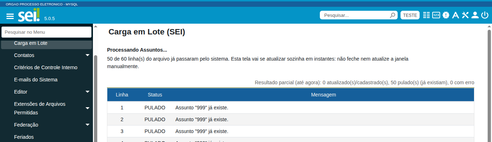

### Simular uma carga

Nas quatro cargas do SEI, marque **Apenas simular: mostra o resultado esperado e não grava nada** antes de clicar em **Processar**. O módulo roda a carga inteira, mostra o relatório linha a linha e desfaz tudo no fim, sem gravar nada. O título da tabela passa a dizer **Simulação, nada foi gravado**. Use a simulação para achar erros de coluna, de referência (órgão, cargo, assunto) e de dado antes de gravar de verdade.

A simulação trata cada linha como a carga real trata: uma linha repetida no mesmo arquivo aparece como PULADO, porque a primeira linha simulada já vale para a segunda. Depois de simular, para gravar de verdade, desmarque a opção e envie o mesmo arquivo.

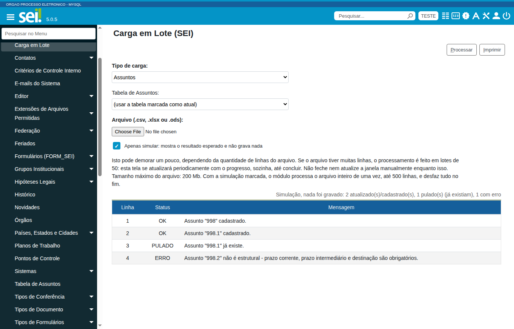

A simulação tem limites:

- Ela processa o arquivo inteiro de uma vez, em até 500 linhas. Com mais linhas, a tela recusa com a mensagem **A simulação aceita até 500 linhas e o arquivo tem N. Simule uma parte do arquivo ou rode a carga sem simular.**
- As cargas do SIP e a tela Unidades pelo SIORG não têm simulação. O cadastro no SIP replica unidades e usuários para o SEI por um serviço do SEI, e o módulo não consegue desfazer essa parte.
- A simulação desfaz o que o módulo grava no banco. Um módulo de terceiros que reaja à gravação com chamada externa não participa desse desfazer.
- O SEI registra a simulação na auditoria, como as demais cargas, com a marca de simulação.

### Ler o relatório

O relatório tem uma linha para cada linha do arquivo, com o número da linha (sem contar o cabeçalho), o **Status** e a **Mensagem**. O título da tabela soma os resultados.

| Status | O que significa |
|---|---|
| OK | O módulo gravou a linha: cadastrou ou atualizou o registro |
| PULADO | O registro já existia e o módulo não mexeu nele (cargas que criam) |
| ERRO | A linha falhou e o módulo não gravou nada dela. A mensagem diz o motivo |

Cada linha roda sozinha: um erro em uma linha desfaz só ela e não interrompe as outras. Por isso você pode corrigir as linhas com erro e reenviar o arquivo: nas cargas que criam, as linhas que já deram certo viram PULADO, e as corrigidas entram.

O botão **Imprimir** (atalho Alt+I) aparece ao lado de **Processar** quando há relatório. Ele abre a impressão do navegador, onde você também pode salvar o relatório em PDF.

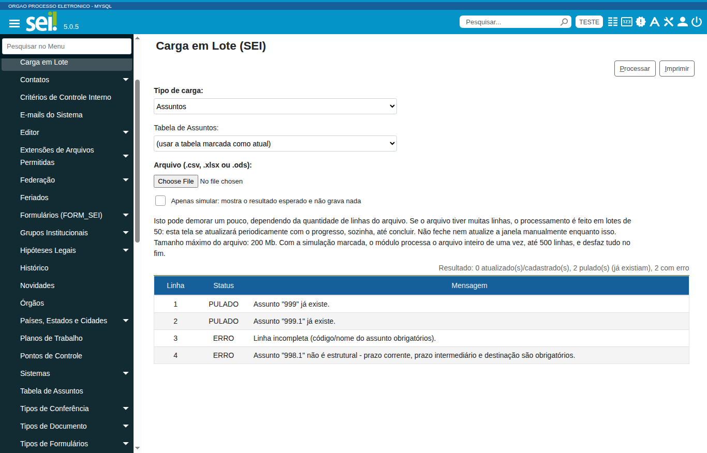

Nas cargas do SIP que juntam duas operações, o relatório lista primeiro as linhas da primeira operação (cadastro das unidades ou dos usuários) e depois as da segunda (hierarquia ou permissão). Por isso o mesmo número de linha aparece duas vezes. O título da tabela traz um resumo para cada operação.

## Cargas no SEI

### Abrir a tela Carga em Lote no SEI

Acesse **Administração > Carga em Lote**. A tela mostra o campo **Tipo de carga**, o campo **Arquivo (.csv, .xlsx ou .ods)** e um texto sobre o processamento em lotes e o tamanho máximo do arquivo.

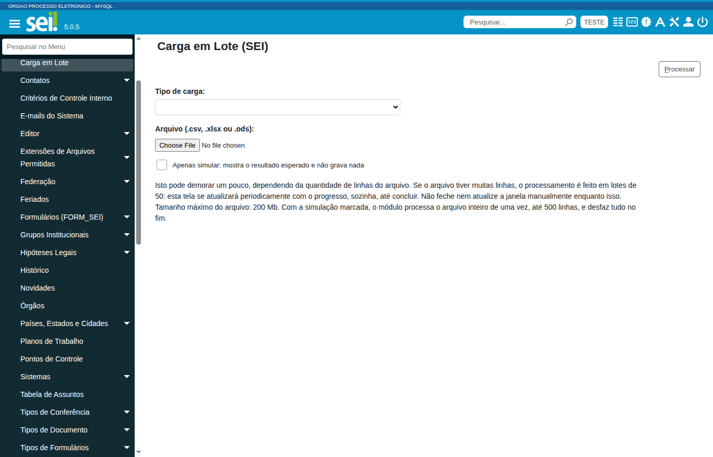

O **Tipo de carga** lista só as cargas que o seu perfil permite. As opções possíveis são Dados Complementares de Unidade, Contato de Usuários, Assuntos e Tipos de Processo.

### Dados Complementares de Unidade

Objetivo: completar com endereço, telefone, site, CNPJ e e-mail as unidades que já existem no SEI. Pré-requisito: a unidade já existe no SEI, por exemplo porque você rodou a carga de Unidades e Hierarquia no SIP e a replicação já trouxe a unidade.

Use o arquivo `exemploContatoUnidades`. A carga usa as colunas abaixo. As colunas **3-descricaoUnidade** e **4-superiorNaHierarquia** existem no arquivo porque ele é o mesmo das cargas do SIP, mas esta carga não as usa.

| Coluna | Como preencher | Regra |
|---|---|---|
| 1-orgaoUnidade | Sigla do órgão | Obrigatória. Se o órgão não existe, a linha dá erro |
| 2-siglaUnidade | Sigla da unidade | Obrigatória. A unidade precisa existir no SEI |
| 5-emailUnidade | E-mail da unidade | Opcional. O módulo acrescenta o e-mail à lista da unidade, sem apagar os que já existem, e não repete um e-mail que a lista já tem |
| 6-usaEndereçoDoÓrgao? | S ou outro valor | Com S, a unidade usa o endereço do órgão. Qualquer outro valor mantém endereço próprio |
| 7-endereçoUnidade | Logradouro | Opcional |
| 8-complementoEndereco | Complemento | Opcional |
| 9-bairroUnidade | Bairro | Opcional |
| 10-UFUnidade | Sigla da UF | Opcional. Se a UF não existe, a linha dá erro |
| 11-cidadeUnidade | Nome da cidade | Opcional. O módulo só usa a cidade quando a UF também está preenchida, e a cidade precisa existir nessa UF |
| 12-CEPUnidade | CEP | Opcional |
| 13-CNPJUnidade | CNPJ | Opcional. O módulo grava o CNPJ formatado |
| 14-telefoneUnidade | Telefone | Opcional. Grava como telefone comercial |
| 15-siteUnidade | Endereço do site | Opcional |

O país é sempre o Brasil. Resultado de uma linha certa: OK com a mensagem **Unidade "SIGLA" atualizada.**

### Contato de Usuários

Objetivo: completar os dados pessoais e de contato de usuários que já existem no SEI. Pré-requisito: o usuário existe no SEI (por exemplo, pela carga de Usuários e Primeiras Permissões no SIP).

Use o arquivo `exemploContatoUsuarios`. Esta carga não tem coluna de órgão: ela procura o usuário pela sigla em todos os órgãos. Se a mesma sigla existir em mais de um órgão, a linha dá erro e lista os órgãos, em vez de escolher um. Se a sigla não existe, o erro é **Usuário "SIGLA" não encontrado.**

| Coluna | Como preencher | Regra |
|---|---|---|
| 1.siglaUsuario | Sigla do usuário | Obrigatória |
| 2.generoUsuario | M ou F, como no exemplo | Opcional, mas informe quando preencher o cargo, porque o módulo procura o cargo pelo par expressão e gênero |
| 3.usaEnderecoDoOrgao | S ou outro valor | Com S, o contato usa o endereço do órgão do usuário |
| 4.enderecoUsuario, 5.complemEndUsuario, 6.bairroUsuario | Endereço, complemento e bairro | Opcionais |
| 7.paisUsuario | Nome do país | Opcional. Vazio ou Brasil usa o Brasil. Outro país precisa existir |
| 8.ufUsuario | Sigla da UF | Opcional. Precisa existir no país |
| 9.cidadeUsuario | Nome da cidade | Opcional. Só vale com a UF preenchida e precisa existir nela |
| 10.cepUsuario | CEP | Opcional |
| 11.cargoUsuario | Expressão do cargo | Opcional. O cargo já precisa estar cadastrado para o gênero informado |
| 12.categoriaUsuario | Nome da categoria | Opcional. A categoria já precisa estar cadastrada |
| 13.funcaoUsuario | Função | Opcional |
| 14.tituloUsuario | Expressão do título | Opcional. O título já precisa estar cadastrado |
| 15.cpfUsuario, 16.rgUsuario, 17.orgaoExpRgUsuario | CPF, RG e órgão expedidor | Opcionais |
| 18.dataNascUsuario | Data no formato dd/mm/aaaa, como no exemplo | Opcional |
| 19.matriculaUsuario, 20.matOabUsuario | Matrícula e matrícula da OAB | Opcionais |
| 21.passaporteUsuario, 22.paisPassaporteUsuario | Número do passaporte e país | Opcionais. Sem o país, vale o país do endereço |
| 23.telefoneComercialUsuario, 24.telefoneCelularUsuario, 25.telefoneResidencialUsuario | Telefones | Opcionais |
| 26.conjugeUsuario, 27.emailUsuario, 28.obsUsuario | Cônjuge, e-mail e observação | Opcionais |

Resultado de uma linha certa: OK com a mensagem **Usuário "SIGLA" atualizado.**

### Assuntos

Objetivo: cadastrar assuntos na Tabela de Assuntos. Esta carga cria registros: uma linha cujo código estruturado já existe na mesma tabela vira PULADO com a mensagem **Assunto "CÓDIGO" já existe.**

Use o arquivo `exemploAssuntos`. Ao escolher o tipo **Assuntos**, a tela mostra o campo **Tabela de Assuntos**. Deixe **(usar a tabela marcada como atual)** para gravar na tabela atual, ou escolha outra tabela pelo nome, por exemplo uma tabela nova que o órgão ainda prepara.

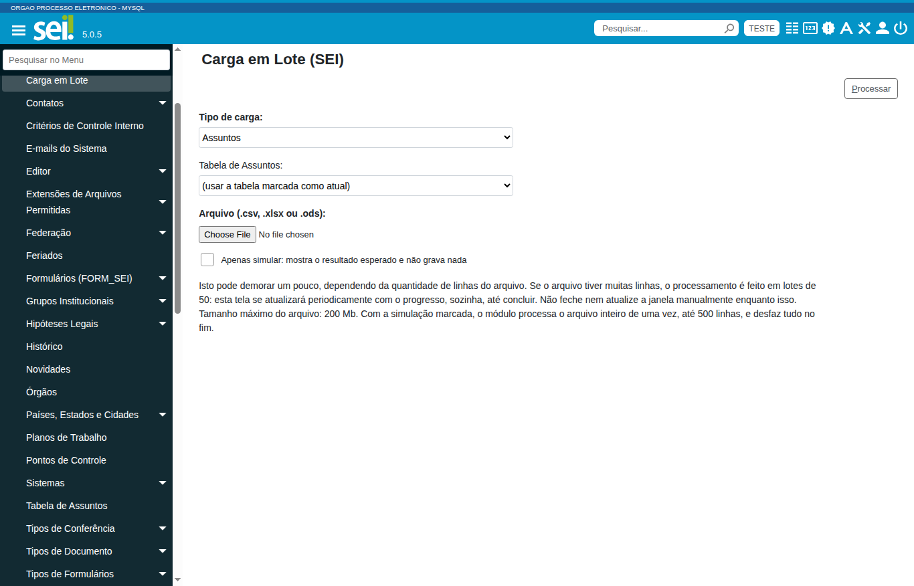

| Coluna | Como preencher | Regra |
|---|---|---|
| 1.CodigoEstruturado | Código do assunto, como 999.1 | Obrigatória. A hierarquia vem do próprio código, e cada linha é independente |
| 2.NomeAssunto | Nome do assunto | Obrigatória |
| 3.chkEstrutural | S para assunto estrutural | Qualquer outro valor conta como não estrutural |
| 4.PrazoCorrente | Prazo na fase corrente | Obrigatório quando o assunto não é estrutural |
| 5.PrazoIntermed | Prazo na fase intermediária | Obrigatório quando o assunto não é estrutural |
| 6.Destinacao | Guarda ou Eliminação | Obrigatória quando o assunto não é estrutural. O módulo reconhece o texto que começa com guarda ou elimina, sem diferenciar maiúsculas nem acentos |
| 7.Obs | Observação | Opcional |

Resultado de uma linha certa: OK com a mensagem **Assunto "CÓDIGO" cadastrado.** Se faltar prazo ou destinação em um assunto não estrutural, o erro é **Assunto "CÓDIGO" não é estrutural - prazo corrente, prazo intermediário e destinação são obrigatórios.** Se faltar código ou nome, o erro é **Linha incompleta (código/nome do assunto obrigatórios).**

### Tipos de Processo

Objetivo: cadastrar tipos de processo com assuntos sugeridos, restrições por órgão e unidade e níveis de acesso. Esta carga cria registros: se já existe um tipo com o mesmo nome e o mesmo valor na coluna 10.exclusivoOuvidoria, a linha vira PULADO com a mensagem **Tipo de Processo "NOME" já existe.**

Use o arquivo `exemploTiposDeProcesso`. A carga usa sempre a Tabela de Assuntos atual para achar os assuntos sugeridos. Rode antes a carga de Assuntos quando o tipo citar assuntos novos.

| Coluna | Como preencher | Regra |
|---|---|---|
| 1.Nome | Nome do tipo | Obrigatória |
| 2.descricao | Descrição | Opcional |
| 3.sugestaoDeAssuntos | Códigos estruturados separados por ponto e vírgula | Opcional. Cada assunto precisa existir na Tabela de Assuntos atual |
| 4.restringirAosOrgaos | Siglas de órgão separadas por ponto e vírgula | Opcional. Restringe o tipo ao órgão inteiro |
| 5.restringirAsUnidades | Órgão e unidades, no formato descrito abaixo | Opcional. Restringe o tipo a unidades do órgão |
| 6.NiveisDeAcessoPermitidos | PUB, RES ou SIG, separados por ponto e vírgula | Obrigatória, com pelo menos um nível |
| 7.NivelDeAcessoSugerido | PUB, RES ou SIG | Obrigatória |
| 8.GrauSigilo | Código do grau de sigilo, como no exemplo | Opcional |
| 9.sugestaoHipoteseLegal | Hipótese legal no formato Nome (Base legal) | Opcional. Precisa existir e ter exatamente esse formato |
| 10.exclusivoOuvidoria | S ou SIM | Qualquer outro valor, inclusive vazio, conta como não |
| 11.permiteContatoAnonimo(ouvidoria) | S ou SIM | Qualquer outro valor conta como não |
| 12.ProcessoUnicoPorInteressado | S ou SIM | Qualquer outro valor conta como não |
| 13.InternoDoSistema | S ou SIM | Qualquer outro valor conta como não |

Na coluna **5.restringirAsUnidades**, escreva o órgão, dois pontos e as unidades separadas por barra vertical, e separe os grupos de órgãos por ponto e vírgula. Exemplo: `ABC:GABIN|SEADM;XYZ:UNID1`. O módulo junta os órgãos das colunas 4 e 5: um órgão só na coluna 4 restringe o órgão inteiro, e um órgão detalhado na coluna 5 restringe só as unidades listadas.

Resultado de uma linha certa: OK com a mensagem **Tipo de Processo "NOME" cadastrado.** Os erros mais comuns estão em [Mensagens de erro nas linhas](#mensagens-de-erro-nas-linhas).

## Cargas no SIP

### Abrir a tela Carga em Lote no SIP

Acesse **Carga em Lote**, no menu do SIP. A tela é igual à do SEI, com os campos **Tipo de carga** e **Arquivo (.csv, .xlsx ou .ods)**, e as opções Unidades e Hierarquia e Usuários e Primeiras Permissões.

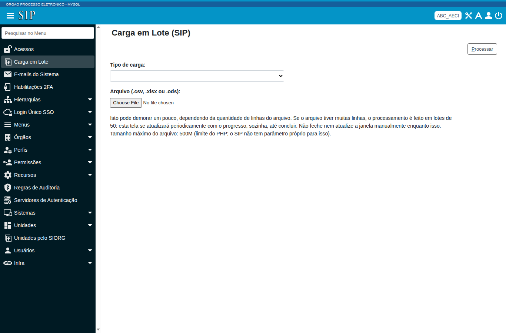

Os passos de [Passos de qualquer carga por arquivo](#passos-de-qualquer-carga-por-arquivo) valem aqui. Cada carga do SIP junta duas operações em uma só passada, com o mesmo arquivo.

### Unidades e Hierarquia

Objetivo: cadastrar unidades e posicionar cada uma na hierarquia do sistema SEI. Use o arquivo `exemploUnidades`. A carga lê só as colunas abaixo. As demais colunas (e-mail, endereço, CNPJ, telefone e site) servem à carga de Dados Complementares de Unidade, no SEI.

| Coluna | Como preencher | Regra |
|---|---|---|
| 1-orgaoUnidade | Sigla do órgão | Obrigatória. O órgão precisa existir |
| 2-siglaUnidade | Sigla da unidade | Obrigatória |
| 3-descricaoUnidade | Nome da unidade | Obrigatória para cadastrar a unidade |
| 4-superiorNaHierarquia | Sigla da unidade superior | Vazia, a unidade fica na raiz da hierarquia. Preenchida, a superior precisa já estar na hierarquia |

Ordene o arquivo de cima para baixo: as unidades raiz primeiro e cada superior antes das suas subunidades. O módulo não reordena as linhas.

Primeira operação, cadastro das unidades: OK com **Unidade "SIGLA" cadastrada.** ou PULADO com **Unidade "SIGLA" já existe.** Segunda operação, hierarquia: OK com **Unidade "SIGLA" posicionada na hierarquia.** ou PULADO com **Unidade "SIGLA" já consta na hierarquia.**

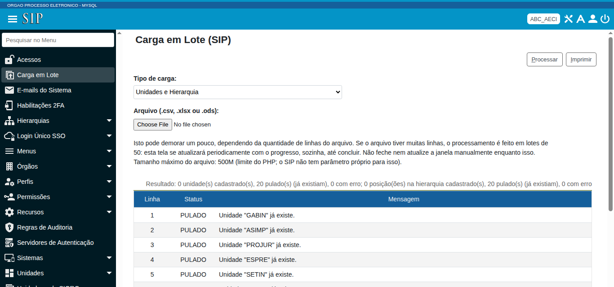

### Usuários e Primeiras Permissões

Objetivo: cadastrar usuários e dar a cada um o primeiro perfil em uma unidade, que ele precisa para entrar no SEI. Use o arquivo `exemploUsuarios`.

| Coluna | Como preencher | Regra |
|---|---|---|
| 1.orgao | Sigla do órgão | Obrigatória. O órgão precisa existir |
| 2.sigla | Sigla do usuário | Obrigatória |
| 3.nome | Nome do usuário | Obrigatória para cadastrar o usuário |
| 4.nomeSocial | Nome social | Opcional |
| 5.cpf | CPF | Opcional. O módulo grava o CPF formatado |
| 6.emailInstitucional | E-mail institucional | Opcional |
| 7.unidadePrimeiraPermissao | Sigla da unidade | Obrigatória para dar a permissão. A unidade precisa existir no órgão |
| 8.perfilPrimeiraPermissao | Nome do perfil do sistema SEI | Obrigatória para dar a permissão. O perfil precisa existir no sistema SEI |

Primeira operação, cadastro dos usuários: OK com **Usuário "SIGLA" cadastrado.** ou PULADO com **Usuário "SIGLA" já existe.** Segunda operação, permissão: OK com **Perfil "PERFIL" concedido a "SIGLA" na unidade "UNIDADE".** ou PULADO com **Usuário "SIGLA" já possui o perfil "PERFIL" na unidade "UNIDADE".**

A permissão nasce válida a partir do dia da carga, sem data de fim, e não se estende às subunidades. Ela usa o tipo de permissão Não Delegável.

## Unidades pelo SIORG

A tela Unidades pelo SIORG traz as unidades de um órgão direto do SIORG, o sistema oficial da estrutura organizacional do governo federal. Você informa o código do órgão no SIORG, a tela lê a estrutura dele pela API pública do SIORG e compara com as unidades do órgão no SIP. Esta tela não usa arquivo.

Acesse **Unidades pelo SIORG**, no menu do SIP. A consulta exige o recurso da tela. Importar, atualizar e desativar exigem um recurso próprio cada um.

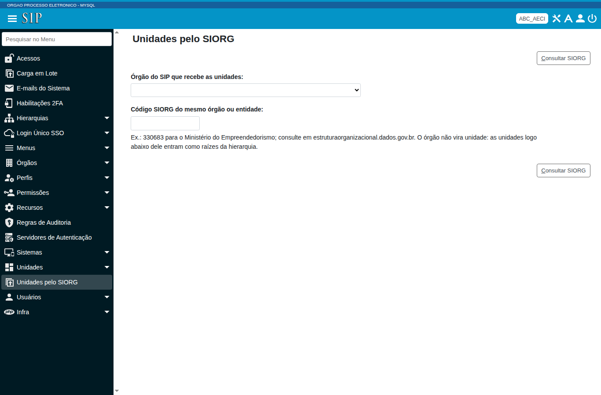

### Consultar a estrutura do órgão

1. Em **Órgão do SIP que recebe as unidades**, escolha o órgão do SIP.
2. Em **Código SIORG do mesmo órgão ou entidade**, digite o código do SIORG, só com números.
3. Clique em **Consultar SIORG** (atalho Alt+C).

O código deve ser o do órgão ou da entidade, e corresponder ao órgão que você escolheu no SIP. O órgão em si não vira unidade: as unidades logo abaixo dele entram como raízes da hierarquia do sistema SEI. Se você informar o código de uma unidade, a tela recusa e pede o código do órgão. Sem o órgão ou com código que não seja número, a tela avisa **Escolha o órgão do SIP e informe o código SIORG do mesmo órgão (só números).**

Se a sigla do órgão no SIP for diferente da sigla do órgão no SIORG, a tela mostra um aviso amarelo no alto. Confira se o código é do mesmo órgão.

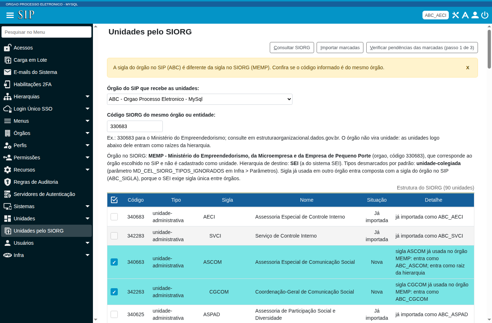

A tabela **Estrutura do SIORG** lista as unidades de cima para baixo, com o recuo da hierarquia na coluna **Sigla**. A coluna **Situação** compara cada unidade com o SIP:

| Situação | O que significa |
|---|---|
| Nova | A unidade ainda não existe no SIP, e você pode importá-la |
| Já importada | A unidade já veio do SIORG e está igual |
| Divergente | A unidade já veio do SIORG, mas o nome, a sigla ou a posição na hierarquia mudou, ou ela está desativada no SIP |
| Conflito | A sigla já existe no órgão em outra unidade |
| Inválida | A sigla está vazia ou passa de 30 caracteres, ou o nome está vazio |
| Bloqueada | A unidade é nova, mas a sua superior está em conflito, inválida ou também bloqueada, e precisa entrar no SIP antes |

A coluna **Detalhe** explica o motivo. Quando a sigla do SIORG já existe em outro órgão, a tela grava a sigla composta com a sigla do órgão no SIP, no formato ORGAO_SIGLA, porque o SEI exige sigla de unidade única entre os órgãos. Unidades de outro órgão ou entidade que aparecem na estrutura (vinculadas) ficam de fora, e a tela avisa quantas.

### Importar unidades

Na tabela, marque as unidades **Nova** que você quer importar. A tela já marca as novas, menos as de tipo ignorado. O tipo ignorado de fábrica é unidade-colegiada, e o administrador muda isso no parâmetro `MD_CEL_SIORG_TIPOS_IGNORADOS`, em Infra > Parâmetros. O ícone de seleção no cabeçalho da primeira coluna marca todas as novas e, ao clicar de novo, desmarca todas. A tela só deixa marcar as unidades novas.

1. Clique em **Importar marcadas** (atalho Alt+I).
2. Confirme a pergunta **Confirma a importação de N unidade(s) para o SIP?**
3. Acompanhe o progresso. A tela importa 10 unidades por vez e se atualiza sozinha.
4. Leia o relatório e, se quiser, clique em **Imprimir relatório** (atalho Alt+P).

Sem nenhuma unidade marcada, a tela avisa **Nenhuma unidade marcada.** O SIP cadastra cada unidade de cima para baixo e a replica para o SEI. Se uma unidade depende de uma superior que ainda não está no SIP, a linha dá erro com a mensagem **A unidade superior SIGLA (SIORG N) ainda não está no SIP. Importe-a antes.**

Reimportar não duplica: o módulo reconhece a unidade já importada pelo código do SIORG, que fica gravado no campo de origem da unidade com o prefixo `SIORG:`.

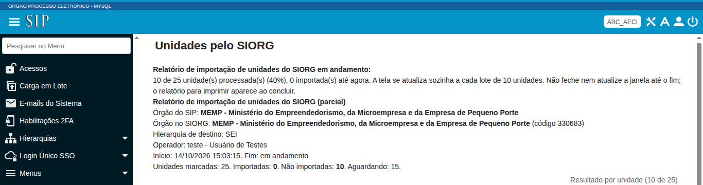

Na figura, o operador marcou 25 unidades que já estavam importadas. Por isso o relatório conta essas unidades como não importadas, com o motivo já importada. Em uma importação de unidades novas, a contagem de importadas sobe a cada lote.

O relatório ao final mostra o órgão do SIP, o órgão no SIORG, a hierarquia de destino, o operador, o início e o fim, a contagem de unidades importadas e não importadas, e uma tabela com uma linha por unidade, com **Situação** Importada ou Não importada e a mensagem do motivo. Cada unidade importada fica registrada na auditoria do SIP.

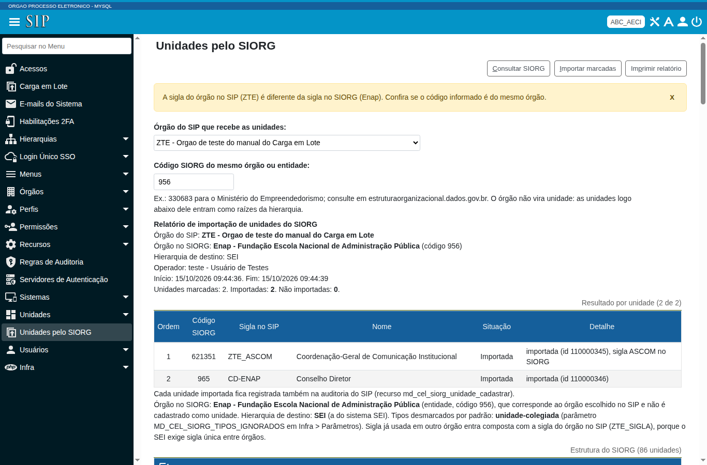

Na figura, a unidade ASCOM entrou como ZTE_ASCOM, porque a sigla ASCOM já existia em outro órgão. A coluna **Detalhe** informa o identificador da unidade no SIP e a sigla que ela tem no SIORG.

### Atualizar sigla e nome

Quando uma unidade já importada muda de sigla ou de nome no SIORG, a situação dela fica **Divergente**, e a tela mostra uma caixa de seleção para atualizar. A atualização também troca no SEI.

1. Marque as unidades divergentes que a tela permite atualizar.
2. Clique em **Atualizar marcadas** (atalho Alt+A).
3. Confirme a pergunta **Confirma a atualização de sigla e nome de N unidade(s) no SIP e no SEI, com os dados do SIORG?**

Sem nenhuma unidade marcada, a tela avisa **Marque as unidades divergentes que quer atualizar.** O botão **Atualizar marcadas** só aparece quando existe alguma unidade atualizável. A tela não atualiza a posição na hierarquia: ela só aponta a diferença no **Detalhe**. Quando a nova sigla já está em uso ou passa de 30 caracteres, o **Detalhe** avisa para atualizar à mão.

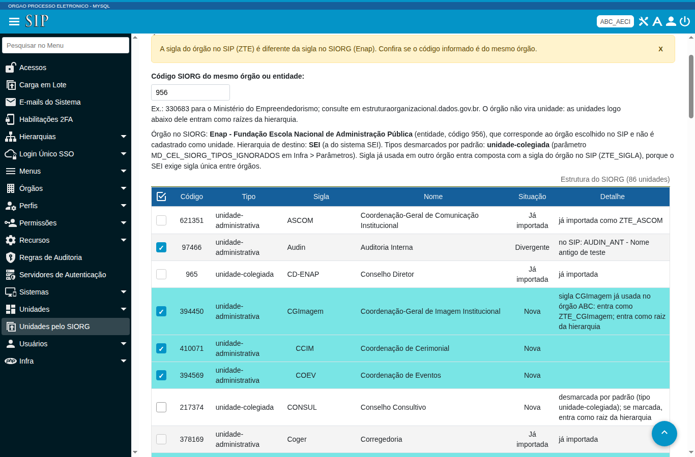

Na figura, a unidade Audin tem no SIP a sigla e o nome diferentes dos do SIORG. A coluna **Detalhe** mostra o que está no SIP, e a caixa de atualização aparece marcada. O botão **Atualizar marcadas** fica na barra de botões, no alto da tela.

Depois da atualização, a tela mostra o relatório com a situação **Atualizada** e, no **Detalhe**, o que a unidade tinha antes no SIP.

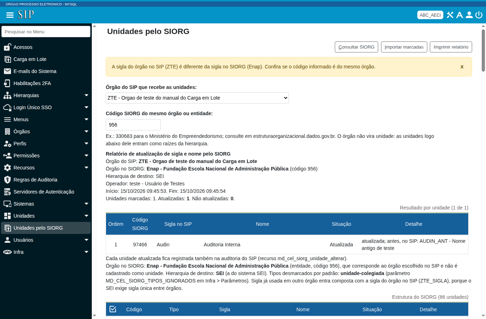

### Desativar unidades que saíram da estrutura

Quando uma unidade do órgão tem código do SIORG, está ativa no SIP e não aparece mais na estrutura do órgão no SIORG, a tela a mostra em **Unidades sinalizadas para desativação**, com o motivo. A tela nunca desativa por conta própria. A desativação exige o aval do administrador em três passos, vale para o SIP e para o SEI e precisa do recurso de desativar.

#### Passo 1, verificar as pendências

1. Na tabela **Unidades sinalizadas para desativação**, marque as unidades que você quer verificar.
2. Clique em **Verificar pendências das marcadas (passo 1 de 3)** (atalho Alt+V).

Esse passo só consulta o SIP e o SEI e não altera nada. Sem unidade marcada, a tela avisa **Marque as unidades sinalizadas que quer verificar.**

#### Passo 2, revisar os alertas

A tela mostra os alertas da desativação e a tabela de verificação. Leia os alertas: a desativação vale para o SIP e para o SEI, apaga no SEI os retornos programados da unidade e a retira dos grupos de envio, e a reativação é manual. A coluna **Situação** diz **Apta** ou **Com pendências**, e a coluna **Pendências e avisos** explica. Só as aptas ficam marcadas, e a tela não deixa marcar as unidades com pendências.

Uma unidade fica com pendências quando tem permissões de usuários no SIP, coordenador de unidade, subunidade ativa que você não marcou, ativação em outra hierarquia, processo aberto no SEI ou bloco não concluído no SEI. A tela desativa as unidades de baixo para cima: se você marca uma subunidade e a superior, a subunidade sai antes.

Para seguir, marque a caixa **Li os alertas acima e confirmo que as unidades marcadas saíram da estrutura do órgão e devem ser desativadas no SIP e no SEI.** Para desistir, clique em **Voltar sem desativar** (atalho Alt+V).

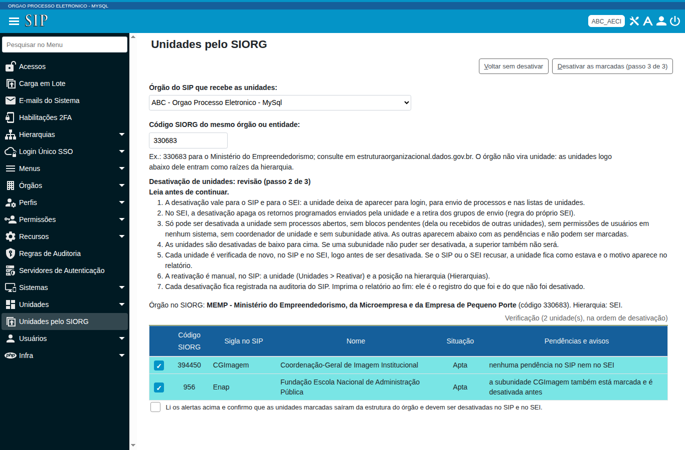

#### Passo 3, confirmar a desativação

1. Clique em **Desativar as marcadas (passo 3 de 3)** (atalho Alt+D).
2. Leia a pergunta de confirmação, que lista as unidades, e confirme.

Sem unidade apta marcada, a tela avisa **Nenhuma unidade apta marcada para desativar.** Sem a caixa de ciência, avisa **Leia os alertas e marque a declaração de ciência antes de desativar.** Antes de desativar cada unidade, o módulo verifica de novo as pendências no SIP e no SEI. Se o SIP ou o SEI recusar, a unidade fica como estava e o motivo aparece no relatório, com a mensagem **não desativada**. Quando dá certo, a mensagem é **desativada no SIP e no SEI**.

Imprima o relatório ao final: ele registra o que a tela desativou e o que ela não desativou. Cada desativação fica na auditoria do SIP. Para reativar uma unidade, use no SIP **Unidades > Reativar** e depois reponha a posição dela em **Hierarquias**.

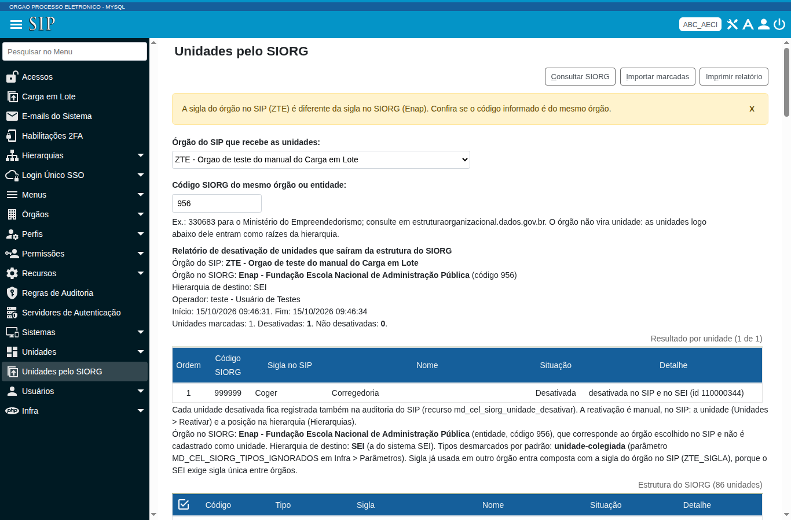

Na figura, a unidade Coger saiu da estrutura do SIORG e o módulo a desativou no SIP e no SEI. A coluna **Detalhe** traz a mensagem **desativada no SIP e no SEI** e o identificador da unidade.

## Solução de problemas

### Erro de arquivo do tipo errado

Se a tela mostra **Arquivo não corresponde ao tipo de carga "TIPO" selecionado (colunas não conferem). Confira se escolheu o arquivo certo.**, o cabeçalho do arquivo não bate com o da carga escolhida. O módulo não processou nada. Confira:

- Você escolheu o arquivo da carga certa. Por exemplo, o arquivo de unidades não serve para Contato de Usuários.
- Você não apagou, não inseriu nem trocou de lugar nenhuma coluna.
- O texto do cabeçalho está igual ao do arquivo de exemplo.

Corrija o arquivo, volte e envie de novo.

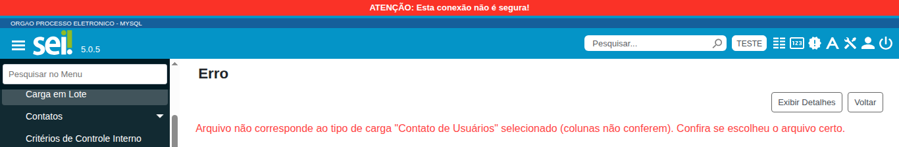

### Mensagens de erro nas linhas

| Mensagem | Quando aparece | O que fazer |
|---|---|---|
| Linha incompleta, com a lista dos campos obrigatórios | Falta um campo obrigatório na linha | Preencha o campo e reenvie |
| Órgão "SIGLA" não encontrado. | A sigla do órgão não existe | Corrija a sigla |
| Unidade "SIGLA" não encontrada no SEI (rode a carga de unidades do módulo SIP antes). | A unidade ainda não chegou ao SEI | Rode Unidades e Hierarquia no SIP e espere a replicação |
| Unidade "SIGLA" não encontrada (rode a carga de unidades antes). | A hierarquia cita uma unidade que o SIP ainda não tem | Rode a carga de unidades |
| Unidade superior "SIGLA" ainda não está na hierarquia (processe as linhas de cima para baixo). | A superior vem depois da subunidade no arquivo | Reordene o arquivo, raízes primeiro |
| Usuário "SIGLA" não encontrado. | O usuário não existe no SEI | Rode Usuários e Primeiras Permissões no SIP |
| Usuário "SIGLA" não encontrado (rode a carga de usuários antes). | A permissão cita um usuário que o SIP ainda não tem | Rode a carga de usuários |
| Perfil "NOME" não encontrado para o sistema informado. | O perfil não existe no sistema SEI | Use o nome exato do perfil |
| UF "SIGLA" não encontrada. | A UF não existe | Corrija a sigla da UF |
| Cidade "NOME" não encontrada na UF "SIGLA". | A cidade não existe na UF informada | Corrija o nome da cidade |
| Cargo "NOME" não encontrado para o gênero informado (cadastre antes em Administração > Contatos > Cargos). | O cargo não está cadastrado para o gênero | Cadastre o cargo ou corrija o gênero |
| Categoria "NOME" não encontrada (cadastre antes em Administração > Contatos > Categorias). | A categoria não está cadastrada | Cadastre a categoria |
| Título "NOME" não encontrado (cadastre antes em Administração > Contatos > Títulos). | O título não está cadastrado | Cadastre o título |
| País "NOME" não encontrado. | O país não existe | Corrija o nome do país |
| Destinação "TEXTO" não reconhecida (use "Guarda" ou "Eliminação"). | A destinação do assunto é outra | Use Guarda ou Eliminação |
| Assunto "CÓDIGO" não encontrado na Tabela de Assuntos atual (cadastre antes pela carga de Assuntos). | O tipo de processo cita um assunto que não existe | Rode antes a carga de Assuntos |
| Nível de acesso "TEXTO" não reconhecido (use PUB, RES ou SIG). | O nível de acesso é outro | Use PUB, RES ou SIG |
| Hipótese legal "TEXTO" não está no formato esperado ("Nome (Base legal)"). | A hipótese legal não segue o formato | Escreva Nome (Base legal) |
| Hipótese legal "TEXTO" não encontrada. | A hipótese legal não existe | Corrija o texto |
| Unidade "SIGLA" não encontrada no órgão "SIGLA". | A restrição cita uma unidade que o órgão não tem | Corrija a sigla da unidade |
| Nenhuma Tabela de Assuntos marcada como atual foi encontrada. | O SEI não tem tabela atual | Marque uma tabela como atual |
| Tabela de Assuntos "NOME" não encontrada. | A tabela escolhida não existe | Escolha uma tabela da lista |
| A simulação aceita até 500 linhas e o arquivo tem N. Simule uma parte do arquivo ou rode a carga sem simular. | A simulação recebeu mais de 500 linhas | Simule uma parte do arquivo ou rode a carga sem simular |

### O SIORG não responde ou recusa o código

Quando o SIORG recusa o código, a tela mostra **O SIORG recusou o código N**, seguido do motivo que o SIORG deu e da orientação de informar o código do órgão ou entidade. Se o código é de uma unidade, a tela mostra **O código SIORG N é de uma unidade**, com a sigla e o nome dela, e pede o código do órgão. Se o serviço não responde, a tela mostra **Falha ao acessar** seguido do endereço do serviço. Nesse caso, tente de novo mais tarde e avise o administrador se o problema continuar, porque o endereço, o tempo limite e o proxy são parâmetros do módulo.

### A verificação de desativação não consegue consultar o SEI

Na coluna **Pendências e avisos**, a mensagem **não foi possível consultar o SEI** indica que o SIP não conseguiu falar com o SEI. A unidade fica **Com pendências**. Avise o administrador do sistema: a comunicação entre o SIP e o SEI está com falha.
